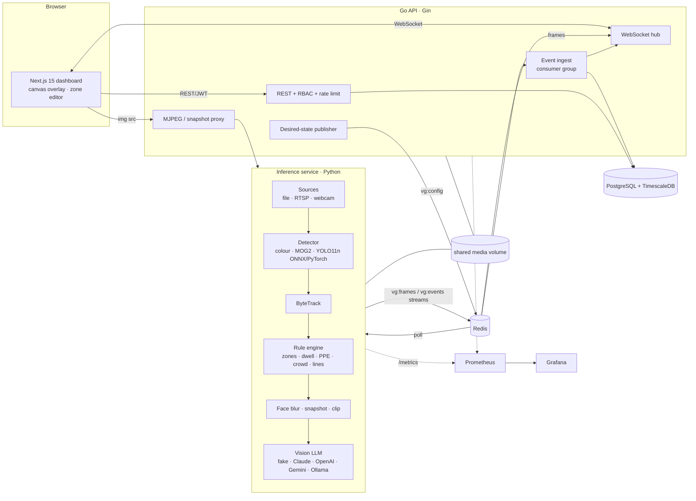
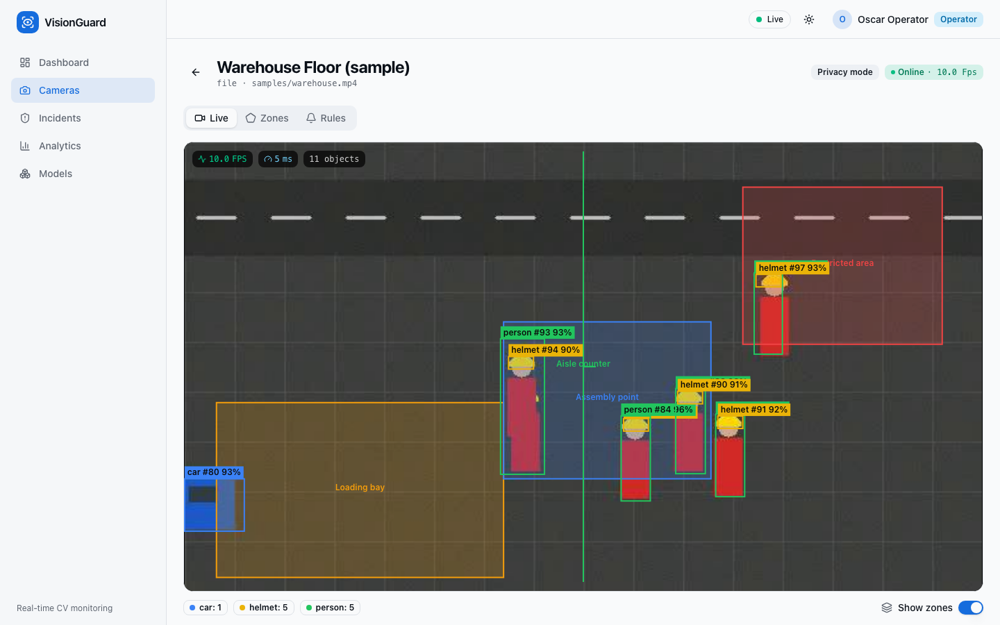
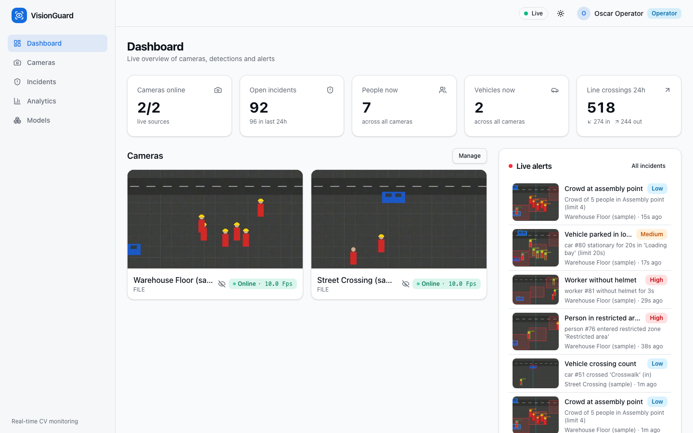
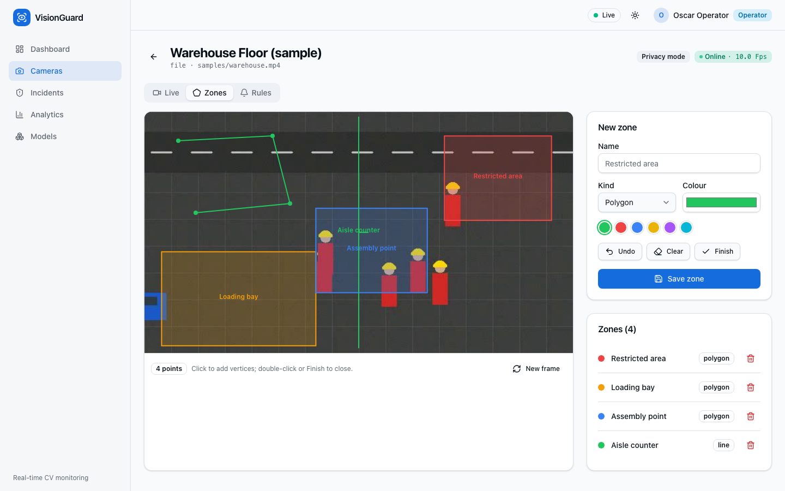
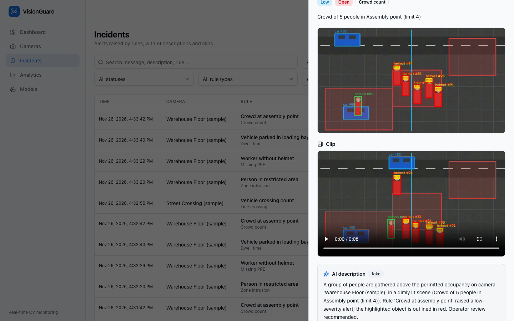
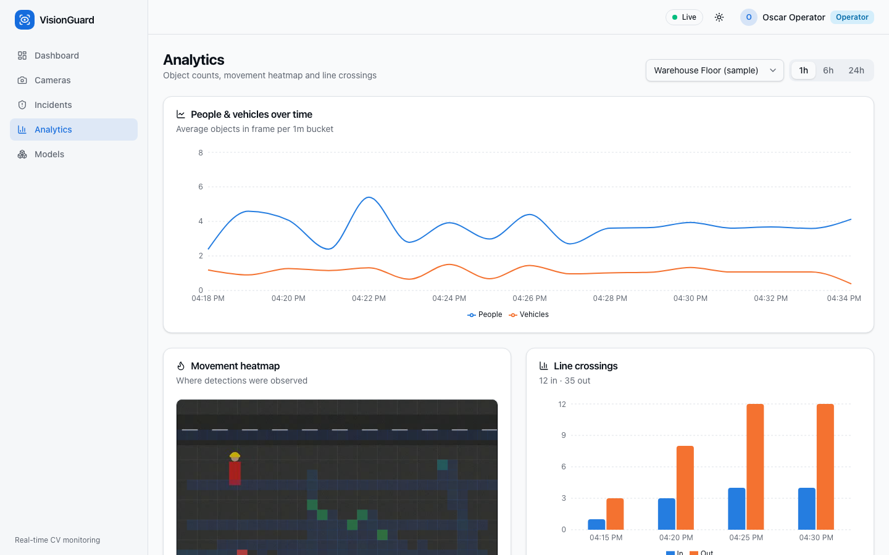
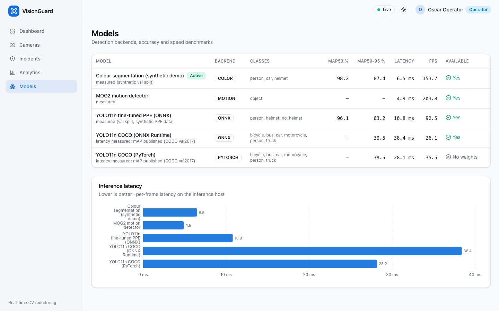
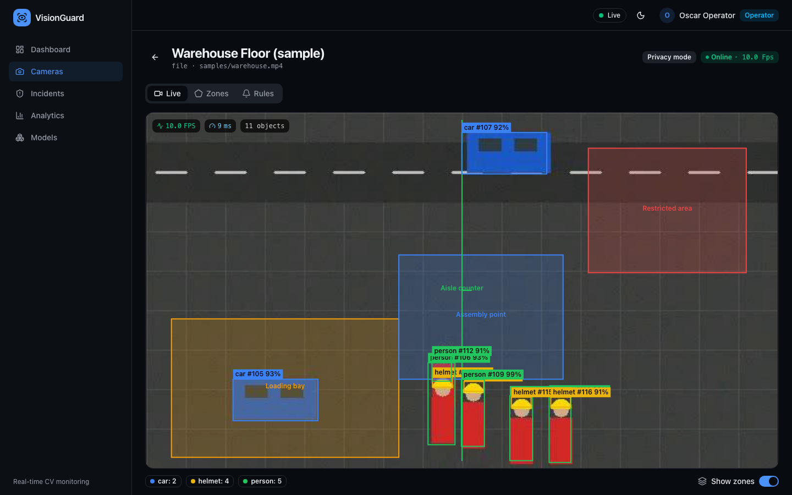
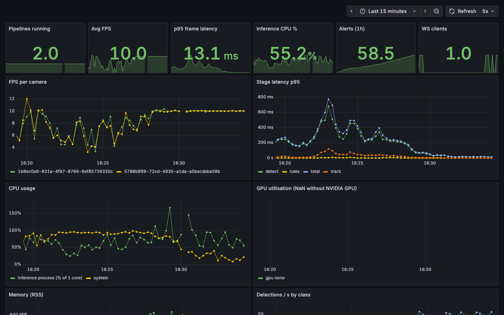

# VisionGuard — Real-Time Computer Vision Monitoring Dashboard

Connect cameras (RTSP, webcam or uploaded video), detect and track people, vehicles and PPE,
draw zones and rules on the video frame, and get live alerts with a face-blurred snapshot, a
short event clip and an AI-written incident description, all on one web dashboard.

> Everything runs offline by default: sample videos are generated with OpenCV, the detector
> defaults to a deterministic colour model for that footage, and incident descriptions come from
> a deterministic "fake" vision LLM. Real YOLO11n (PyTorch/ONNX) and real vision LLMs (Claude,
> OpenAI, Gemini, Ollama) are one setting away.

## Features

| # | Feature | Where |
|---|---|---|
| 1 | Camera sources: RTSP URL, webcam index, uploaded video file; two generated sample videos (warehouse, street) | `ml/src/visionguard_ml/sources.py`, `samples.py`, `POST /cameras`, `/cameras/upload` |
| 2 | Live view: MJPEG stream + canvas overlay with boxes, class labels, track IDs, confidence and an FPS/latency counter | `frontend/src/components/cameras`, `lib/overlay.ts` |
| 3 | Zone editor (polygons and counting lines on a still frame) and rules: restricted-zone intrusion, vehicle dwell > N s, worker without helmet, crowd > N, line crossing | `rules/engine.py`, `handlers_config.go` |
| 4 | Real-time alerts over WebSocket with snapshot; optional email (SMTP) and Telegram notifications per rule | `ws/hub.go`, `notify/notify.go` |
| 5 | Analytics: people/vehicle counts over time, movement heatmap, line-crossing counts in/out (TimescaleDB) | `store/analytics.go`, `/analytics` page |
| 6 | Incident log: full-text search, filters, AI description, event clip (4 s before + 4 s after) | `store/incidents.go`, `/incidents` page |
| 7 | Model management: switch detectors live (colour demo, MOG2 motion, YOLO11n PyTorch/ONNX, fine-tuned PPE), mAP + latency benchmarks; fine-tuning script and notebook | `detectors/`, `scripts/train_ppe.py`, `notebooks/finetune_ppe.ipynb` |
| 8 | ONNX export and a measured PyTorch vs ONNX Runtime CPU benchmark | `scripts/export_onnx.py`, `scripts/benchmark.py`, [results](#pytorch-vs-onnx-runtime-cpu-benchmark) |
| 9 | System metrics (FPS, per-stage latency, CPU, memory, GPU when present) in Grafana | `metrics.py`, `infra/grafana` |
| 10 | Privacy mode: faces (Haar cascade) and head regions are blurred in every stored snapshot and clip | `privacy.py` |

Also included: JWT access tokens with rotating refresh tokens and RBAC (admin, operator, viewer),
rate limiting, structured JSON logs, OpenAPI/Swagger, dark/light mode, a seed with realistic
history, Docker Compose (CPU by default, optional GPU profile), GitHub Actions CI, and unit,
integration, edge-case, component and Playwright e2e tests.

## Architecture



How a frame is processed. The inference service decodes it, runs the active detector, updates
ByteTrack, and evaluates every rule for that camera against the tracks (anchored at each
object's feet). It then publishes the frame's tracks to `vg:frames`. When a rule fires, it saves
a privacy-blurred snapshot, emits an `alert` on `vg:events`, starts recording a clip from a
pre-event ring buffer, and asks the vision LLM for a description in a background thread. The
clip and the description arrive later as `incident_update` events.

The Go API consumes `vg:events` with a consumer group (at least once, with idempotent writes),
persists the events to TimescaleDB, and pushes them to browsers. Rule and zone edits are written
back as a versioned desired-state document. The inference service hot-reloads it without
restarting the capture.

## Tech stack

| Layer | Technology |
|---|---|
| Frontend | Next.js 15 (App Router), React 19, TypeScript (strict), Tailwind CSS v4, shadcn/ui-style Radix components, recharts, HTML canvas, native WebSocket client |
| API | Go 1.27, Gin, pgx v5, go-redis v9, golang-jwt v5, gorilla/websocket, Prometheus client, slog |
| Inference | Python 3.12, OpenCV 5, ONNX Runtime, Ultralytics YOLO11n (optional extra), own ByteTrack (numpy/scipy), FastAPI, Anthropic & OpenAI SDKs (httpx2), Gemini/Ollama REST |
| Data | PostgreSQL 17 + TimescaleDB (hypertables, retention, continuous aggregate), Redis 7 Streams |
| Ops | Docker Compose (CPU default, `gpu` profile), Prometheus, Grafana, GitHub Actions |
| Tests | pytest + fakeredis, Go testing + testify + miniredis + real TimescaleDB, Vitest + Testing Library, Playwright |

## Screenshots

All screens below show the synthetic demo scenes running live in `docker compose`. Regenerate them
with `node scripts/screenshots.mjs`.

**Live view.** The MJPEG stream has a canvas overlay with class labels, track IDs, confidence,
zones and an FPS/latency counter.


**Dashboard.** KPIs, live camera tiles and the real-time alert feed with face-blurred snapshots.


**Zone editor.** A new polygon being drawn on a still frame, next to the existing zones and
counting line.


**Incident detail.** The face-blurred snapshot with offenders outlined in red, the event clip and
the AI-written description.


**Analytics.** People and vehicle counts over time, the movement heatmap and line-crossing counts
in/out.


**Model management.** The detector catalogue with measured latency/FPS, mAP, and switching the
live model.


**Dark mode.** The live view in dark mode.


**Grafana.** System metrics: FPS per camera, per-stage latency, CPU and memory, and GPU when
present.


## Local setup

Prerequisites: Docker Desktop. For development outside Docker you also need `uv` (Python
3.12), Go 1.27 and Node 22+.

```bash
cp .env.example .env              # optional; defaults work out of the box
docker compose up -d --build --wait
./scripts/smoke.sh                # scripted end-to-end check of every feature
```

| Service | URL |
|---|---|
| Dashboard | http://localhost:20900 (log in as `operator@visionguard.dev` / `operator12345`) |
| API + Swagger | http://localhost:20901/api/docs |
| Inference service | http://localhost:20902/health |
| Prometheus | http://localhost:20920 |
| Grafana | http://localhost:20921 (dashboard *VisionGuard – System Overview*) |
| TimescaleDB / Redis | `localhost:20910` / `localhost:20911` |

Demo accounts (seeded): `admin@visionguard.dev` / `admin12345`, `operator@visionguard.dev` /
`operator12345`, `viewer@visionguard.dev` / `viewer12345`.

**Real YOLO models.** Weights are never committed. Download and export them with:

```bash
make models     # ml/models/yolo11n.pt + yolo11n.onnx (mounted read-only into the inference container)
make bench      # re-measure and update ml/benchmarks/results.json
make train      # fine-tune the PPE model -> ml/models/ppe-yolo11n.onnx
```

After that, activate *YOLO11n COCO (ONNX Runtime)* on the Models page (admin). A webcam does not
work inside Docker Desktop on macOS; run the inference service natively for that
(`cd ml && uv run visionguard-inference`).

**Development loop.**

```bash
docker compose up -d timescale redis
(cd ml && uv sync && VG_DATA_DIR=../data uv run visionguard-inference)
(cd backend && VG_DATA_DIR=../data VG_AUTO_SEED=true go run ./cmd/api)
(cd frontend && npm install && npm run dev)       # http://localhost:20900
```

**Tests.**

```bash
make test            # ml + api (needs timescale) + frontend unit/component tests
make lint
make e2e             # Playwright against the running stack
```

## Environment variables

| Variable | Default | Description |
|---|---|---|
| `VG_ENV` | `development` | `production` makes `VG_JWT_SECRET` mandatory |
| `VG_JWT_SECRET` | dev-only value | HS256 signing secret (≥ 16 chars) |
| `VG_ACCESS_TTL` / `VG_REFRESH_TTL` | `15m` / `168h` | Token lifetimes |
| `VG_DATABASE_URL` | compose TimescaleDB | PostgreSQL DSN |
| `VG_REDIS_URL` | `redis://redis:6379/0` | Redis for streams/config |
| `VG_INFERENCE_URL` | `http://inference:8000` | Inference service (stream proxy) |
| `VG_DATA_DIR` | `/data` | Shared volume: videos, snapshots, clips |
| `VG_CORS_ORIGINS` | `http://localhost:20900,...` | Browser origin allow-list (also WebSocket) |
| `VG_RATE_LIMIT_RPS` / `_BURST` | `30` / `90` | Per-IP API limit |
| `VG_AUTH_RATE_LIMIT_PER_MIN` | `20` | Per-IP login/register limit |
| `VG_MAX_UPLOAD_MB` | `200` | Video upload limit |
| `VG_AUTO_SEED` | `true` | Seed demo users, cameras, zones, rules and 6 h of history on first start |
| `VG_SMTP_HOST`, `_PORT`, `_USERNAME`, `_PASSWORD`, `_FROM`, `_TO` | empty | Email notifications (off when host is empty) |
| `VG_TELEGRAM_BOT_TOKEN`, `VG_TELEGRAM_CHAT_ID` | empty | Telegram notifications (off when empty) |
| `VG_VISION_PROVIDER` | `fake` | `fake`, `anthropic`, `openai`, `gemini` or `ollama` |
| `VG_VISION_MODEL` | per provider | e.g. `claude-opus-5-5` for Anthropic |
| `VG_ANTHROPIC_API_KEY`, `VG_OPENAI_API_KEY`, `VG_GEMINI_API_KEY` | empty | Provider credentials |
| `VG_OLLAMA_BASE_URL` | `http://host.docker.internal:11434` | Local Ollama |
| `VG_DEFAULT_MODEL` | `color-synthetic` | Detector used until an admin activates another |
| `NEXT_PUBLIC_API_URL` | `http://localhost:20901` | API base URL baked into the frontend build |
| `POSTGRES_PASSWORD`, `GRAFANA_ADMIN_PASSWORD` | `visionguard` | Local service passwords |

## API docs

* Swagger UI: http://localhost:20901/api/docs (spec: `backend/internal/httpapi/openapi.yaml`)
* Human-readable contract including WebSocket messages: [`docs/API.md`](docs/API.md)

## PyTorch vs ONNX Runtime CPU benchmark

Measured with `scripts/benchmark.py` on the dev machine: Apple Silicon, 10 cores, macOS, 4
inference threads, 100 iterations after 10 warm-up runs, on two real photos plus three synthetic
frames, 640 px wide, letterboxed to 640×640. Detection latency only (decode + NMS included,
tracking excluded). The host was shared with other workloads (load average about 7 for this
run). Repeat runs at higher load were about 20–35% slower in absolute terms, and the ranking
never changed. Raw output is in [`ml/benchmarks/results.json`](ml/benchmarks/results.json).

| Model / runtime | mean ms | p50 ms | p95 ms | FPS | mAP |
|---|---|---|---|---|---|
| YOLO11n, PyTorch 2.15 (Ultralytics, CPU) | 28.2 | 26.6 | 33.0 | 35.5 | 39.5 mAP50-95 (published, COCO val2017) |
| YOLO11n, ONNX Runtime 1.32, CPU EP | 38.4 | 37.8 | 42.0 | 26.1 | same weights |
| YOLO11n, ONNX Runtime 1.32, CoreML EP (macOS only) | **18.9** | 18.7 | 20.0 | **52.8** | same weights |
| YOLO11n fine-tuned PPE, ONNX @320 (5 epochs, `scripts/train_ppe.py`) | 10.8 | 10.7 | 11.6 | 92.5 | 96.1 mAP50 / 63.2 mAP50-95 (measured, synthetic val) |
| colour-synthetic (demo detector) | 6.5 | | | 153.7 | 98.2 mAP50 / 87.4 mAP50-95 (measured, synthetic val) |
| MOG2 motion | 4.9 | | | 203.8 | n/a |
| Full colour detect → ByteTrack → rules pipeline | 5.4 | | | 184.2 | |

What this means:

* On this ARM CPU, **PyTorch beat ONNX Runtime's default CPU execution provider by about
  1.36×**. PyTorch's ARM kernels are well tuned, and the ONNX graph ran with stock settings,
  without quantisation or graph tuning.
* With the CoreML execution provider, the same ONNX file is **1.49× faster than PyTorch**
  (18.9 ms vs 28.2 ms). The real win of exporting to ONNX is that one artifact runs on CPU,
  CoreML, CUDA or TensorRT without PyTorch installed.
* An earlier run on a quieter host measured 40.8 ms for PyTorch and 21.5 ms for ONNX. That ONNX
  run used `get_available_providers()`, which silently picked CoreML, so it is not a CPU-only
  number. The serving code now pins `CPUExecutionProvider` unless told otherwise.
* The serving image ships ONNX Runtime CPU only, without PyTorch. Inside the Docker Desktop VM,
  with both demo cameras on YOLO11n and the host loaded, the live pipeline reached about 3.5–3.8
  FPS per camera at about 415 ms per frame. The real-time demo therefore runs the colour detector
  at 10 FPS by default.

## Measured performance (live stack)

Measured from the running `docker compose` stack by `scripts/smoke.sh` and Prometheus (two
demo cameras, colour detector, 10 FPS target, privacy blur on):

| Metric | Value |
|---|---|
| Live FPS per camera (WebSocket frame timestamps, 5 s window) | 9.6–10.0 (target 10) |
| Per-frame processing latency (detect + track + rules), mean over WS frames | 9.0–29.1 ms across runs |
| Median per-frame latency (Prometheus p50, total stage) | 8.7 ms |
| Alerts fired in one 60 s video loop (warehouse) | intrusion, missing helmet, dwell (> 20 s), crowd (> 4); 5–13 live incidents per run |
| Time from rule firing to clip + AI description in DB | < 10 s (4 s post-roll + encode) |
| API p95 request latency | 82 ms |
| Smoke test | 44/44 checks passed (two consecutive runs) |
| Playwright e2e | 2/2 passed (two consecutive runs) |

## Deployment guide

1. **Build images.** Build the four images (`backend/`, `ml/`, `frontend/` with
   `--build-arg NEXT_PUBLIC_API_URL=https://api.example.com`) and push them to your registry.
2. **Managed data stores.** Use PostgreSQL with the TimescaleDB extension (Timescale Cloud, or
   self-hosted) and Redis 7 with AOF persistence. The API runs migrations on start and holds an
   advisory lock, so several replicas are safe.
3. **Secrets.** Set `VG_ENV=production`, a random `VG_JWT_SECRET`, DB/Redis URLs, CORS origins
   and any SMTP, Telegram or vision-LLM keys from your secret manager. Never bake them into images.
4. **Topology.** Run the API (stateless, scale horizontally; each replica gets a unique
   `VG_CONSUMER_NAME`) behind a TLS-terminating load balancer that allows WebSocket upgrades.
   Run inference services next to the cameras (one per GPU or edge box) and give them the shared
   media volume, or swap it for object storage. Put the Next.js frontend behind a CDN.
5. **GPU.** `docker compose --profile gpu up` builds the inference image with
   `onnxruntime-gpu` and reserves NVIDIA devices (needs the NVIDIA container toolkit; untested
   here).
6. **Observability.** Scrape `/metrics` on the API and the inference service. Import
   `infra/grafana/dashboards/visionguard.json`.

## What I learned / key engineering decisions

The full list is in [`docs/DECISIONS.md`](docs/DECISIONS.md). Highlights:

* **The rule engine sits where the state is.** Dwell time and PPE rules need per-track history
  at frame rate, so rules are evaluated in the inference service. The API owns rule definitions
  and publishes a versioned desired-state document that the inference service hot-reloads.
* **Two delivery guarantees on one bus.** Durable events use a Redis Streams consumer group with
  `XACK` and idempotent `ON CONFLICT` writes (the producer generates incident IDs). Live frames
  use a capped stream tailed from `$`, because a late bounding box is worthless.
* **ONNX for portable serving, measured honestly.** ONNX Runtime's default CPU provider was
  slower than PyTorch on Apple Silicon, while the CoreML provider was 1.49× faster. The serving
  image stays PyTorch-free, and the GPU profile swaps in `onnxruntime-gpu`. The NMS and letterbox post-processing are written in
  numpy and unit tested.
* **Own ByteTrack.** It uses a Kalman filter and two-stage association that recovers occluded
  objects from low-confidence detections. Matching is class-aware, and it is tested against ID
  churn, jitter and dropouts.
* **Deterministic offline demo.** The synthetic scene renderer and the colour detector make every
  rule reproducible in tests and CI without downloading weights or footage. Real models are
  benchmarked honestly: latency is measured here, and COCO mAP is quoted from Ultralytics.
* **Backpressure everywhere.** Stream sources keep only the newest frame. A slow detector drops
  frames instead of queueing them, slow WebSocket clients are dropped instead of blocking the
  hub, and the frames stream is length-capped.
* **Security by default.** Refresh tokens rotate with reuse detection, query-string tokens are
  allowed only for media and WebSocket requests, file sources are confined to the video
  directory, RTSP credentials are redacted from logs, all containers run as non-root, and CORS
  uses an allow-list.
